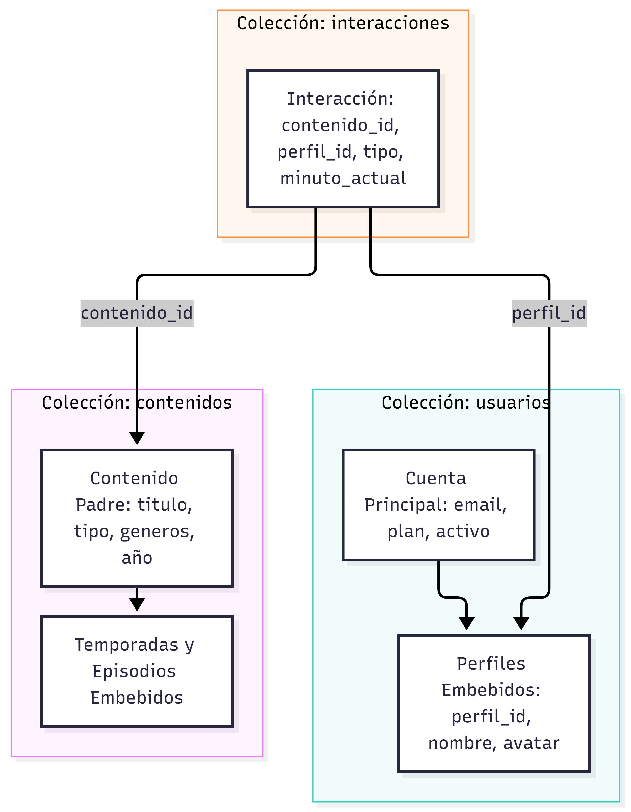
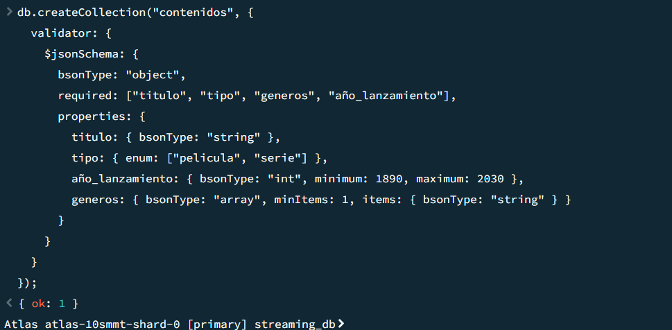
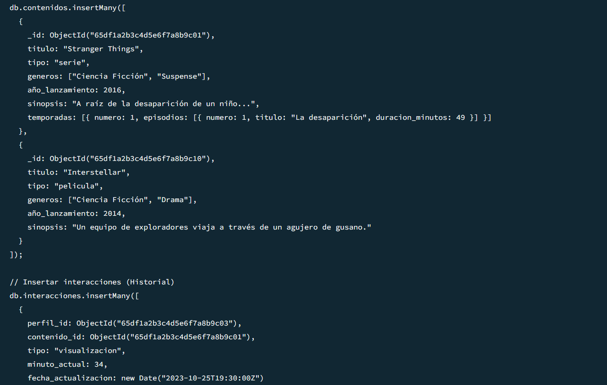
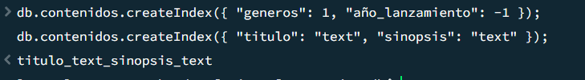
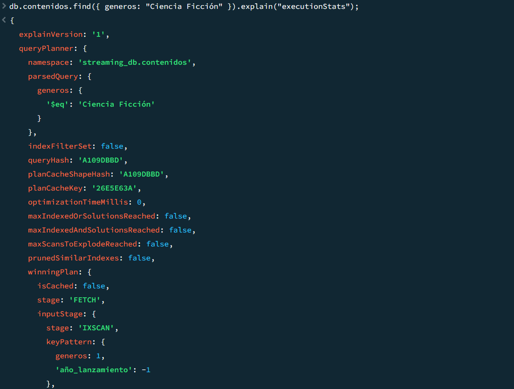
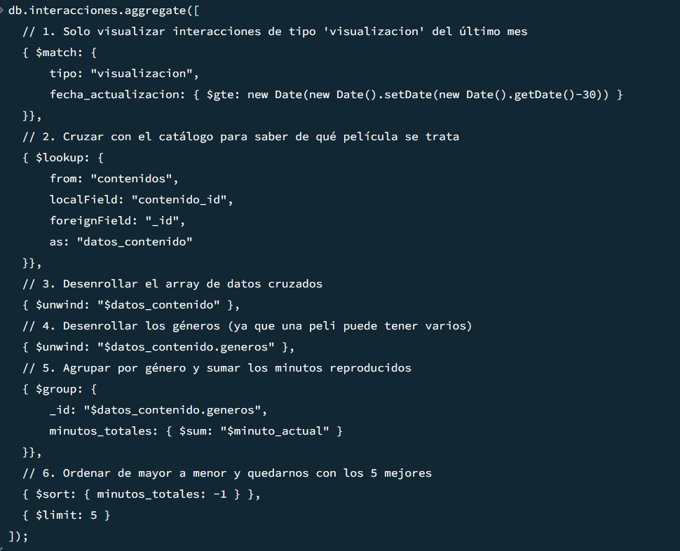
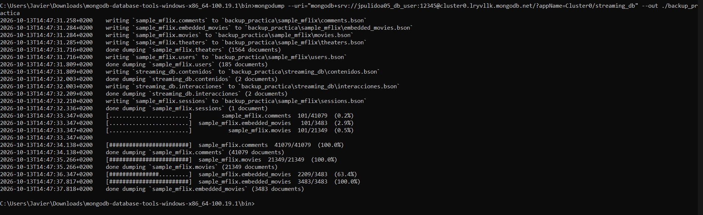

# Solución: Práctica 01 - Modelado con MongoDB


## 1. Definir el problema y los accesos

### 1.1 Escenario Elegido y Usuarios
**Escenario:** Plataforma Multimedia (Tipo Netflix) que gestiona un catálogo de series/películas y el historial de visualización masivo.
**Usuarios del sistema:**
*   **Espectador (Perfiles):** Busca contenido, reproduce videos y valora.
*   **Gestor de Contenido:** Añade nuevas temporadas, películas y metadatos.
*   **Sistema Analítico:** Calcula popularidad y recomienda contenido.

### 1.2 Preguntas de Negocio
1. ¿Qué películas o series del género 'Ciencia Ficción' están disponibles, ordenadas por su año de lanzamiento?
2. ¿Qué contenidos coinciden cuando un usuario busca términos específicos (ej. 'espacio') en la barra superior?
3. Al abrir la ficha de una serie, ¿cuáles son todas sus temporadas, episodios y duraciones?
4. ¿Cuáles son las valoraciones (estrellas/comentarios) de los usuarios sobre un contenido específico?
5. ¿Cuál es el historial de visualización ("Seguir viendo") de un perfil, ordenado por última reproducción?
6. ¿Cuáles son los 5 géneros más populares del mes basados en los minutos reproducidos?

### 1.3 Datos leídos y escritos con mayor frecuencia
*   **Lecturas masivas (85%):** Carga inicial de carruseles, búsquedas en catálogo y apertura de fichas de series.
*   **Escrituras (15%):** Actualización constante del "minuto actual" de reproducción (telemetría de video) e inserción de valoraciones.

### 1.4 Tabla de Patrones de Acceso
| Pregunta de Negocio | Colección | Filtros y Ordenación | Paginación / Límite |
| :--- | :--- | :--- | :--- |
| **P1. Filtro Género** | `contenidos` | Filtro `generos`, Orden `año_lanzamiento: -1` | `skip`, `limit` (20) |
| **P2. Búsqueda Texto** | `contenidos` | Índice `$text` (`titulo`, `sinopsis`) | Primeros 20 resultados |
| **P3. Ficha Serie** | `contenidos` | Búsqueda por `_id`. Array embebido | Documento único |
| **P4. Valoraciones** | `valoraciones` | Filtro `contenido_id`, Orden `fecha: -1` | Paginación de 10 en 10 |
| **P5. Seguir viendo** | `interacciones` | Filtro `perfil_id`, Orden `fecha_act: -1` | Límite 10 |
| **P6. Top Analítico** | `interacciones` | `$lookup` con `contenidos`, `$group` | Top 5 |

### 1.5 Requisitos de Seguridad, Privacidad y Disponibilidad
*   **Seguridad:** Tráfico TLS, acceso mediante SCRAM-SHA-256.
*   **Privacidad:** Separación estricta de datos de facturación (`usuarios`) del comportamiento de visualización (`interacciones`) para facilitar el cumplimiento del RGPD.
*   **Disponibilidad:** Uso de *Replica Sets* (3 nodos). La caída de un nodo primario lanza una elección automática para mantener el catálogo siempre en línea.

---

## 2. Diseñar las colecciones


### 2.1 Colecciones y su propósito
1.  **`contenidos`:** Catálogo central.
2.  **`usuarios`:** Cuentas de facturación y sub-perfiles.
3.  **`interacciones`:** Progreso de visualización individual (crecimiento masivo).
4.  **`valoraciones`:** Opiniones de la comunidad.

### 2.2 Documentos de ejemplo JSON/BSON
**Colección `contenidos` (Serie con incrustación)**
```json
{
  "_id": ObjectId("65df1a2b3c4d5e6f7a8b9c01"),
  "titulo": "Stranger Things",
  "tipo": "serie",
  "generos": ["Ciencia Ficción", "Suspense"],
  "año_lanzamiento": 2016,
  "temporadas": [
    {
      "numero": 1,
      "episodios": [
        { "numero": 1, "titulo": "La desaparición", "duracion": 49 }
      ]
    }
  ]
}
```

### 2.3 Decisiones de Incrustación y Referencia
*   **Incrustación (Temporadas en Contenidos / Perfiles en Usuarios):** Tienen baja cardinalidad (ej. max 5 perfiles, <200 episodios). Permite obtener la ficha completa con un solo acceso a disco.
*   **Referencia (Interacciones y Valoraciones separadas):** Alta cardinalidad y crecimiento exponencial. Un usuario ve miles de videos. Si los incrustamos, rebasaríamos el límite de 16MB y sufriríamos el anti-patrón *Unbounded Array*.

### 2.4 Estrategia de Identificadores, Fechas y Campos
*   **Identificadores:** `ObjectId` para garantizar unicidad y aprovechar el *timestamp* interno.
*   **Fechas:** Tipo `Date` nativo de BSON en UTC para posibilitar operadores lógicos (`$gte`, `$lt`).
*   **Campos Opcionales:** `temporadas` solo existe si el campo `tipo` es igual a `"serie"`.

### 2.5 Límites del Modelo y Operaciones Incómodas
*   **Límite de 16MB:** Controlado al separar las colecciones de histórico.
*   **Operaciones incómodas:** Renombrar un actor o un género implicaría un `$updateMany` masivo en el catálogo, lo cual penaliza las escrituras, pero optimiza enormemente las lecturas (que son el 85% del tráfico).

---

## 3. Implementar validación e índices

### 3.1 Validación con $jsonSchema
```javascript
db.createCollection("contenidos", {
  validator: {
    $jsonSchema: {
      bsonType: "object",
      required: ["titulo", "tipo", "generos", "año_lanzamiento"],
      properties: {
        titulo: { bsonType: "string" },
        tipo: { enum: ["pelicula", "serie"] },
        año_lanzamiento: { bsonType: "int", minimum: 1890, maximum: 2030 },
        generos: { bsonType: "array", minItems: 1, items: { bsonType: "string" } }
      }
    }
  }
});
```


### 3.2 Inserción de Datos de Prueba
Inserción de documentos para poder ejecutar consultas posteriores:


### 3.3 Creación de Índices Justificados
```javascript
// 1. Índice Compuesto: Acelera filtros del catálogo (Pregunta 1)
db.contenidos.createIndex({ "generos": 1, "año_lanzamiento": -1 });

// 2. Índice de Texto: Acelera búsquedas por palabras clave (Pregunta 2)
db.contenidos.createIndex({ "titulo": "text", "sinopsis": "text" });

// 3. Índice Compuesto: Optimiza "Seguir Viendo" (Pregunta 5)
db.interacciones.createIndex({ "perfil_id": 1, "fecha_actualizacion": -1 });
```


### 3.4 Explicación del Coste con Explain
Se ejecuta `explain("executionStats")` en una consulta de filtrado. Se evidencia el paso de escanear todos los documentos (`COLLSCAN`) a usar el árbol B-Tree del índice (`IXSCAN`), reduciendo el número de documentos examinados drásticamente.


---

## 4. Resolver consultas y una agregación compleja

### 4.1 Inserción y Actualización (Upsert)
Cuando un usuario avanza en un video, se actualiza el minuto o se crea si es nuevo:
```javascript
db.interacciones.updateOne(
  { perfil_id: ObjectId("..."), contenido_id: ObjectId("...") },
  { $set: { minuto_actual: 45, fecha_actualizacion: new Date() } },
  { upsert: true }
);
```

### 4.2 Filtros Combinados y Paginación
```javascript
db.contenidos.find({ generos: "Ciencia Ficción" })
  .sort({ año_lanzamiento: -1 })
  .skip(0).limit(20);
```

### 4.3 y 4.4 Agregación Compleja (Top 5 Géneros)
Resolución de la Pregunta 6 usando 5 etapas de agregación: `$match`, `$lookup`, dos `$unwind`, `$group`, `$sort` y `$limit`.

```javascript
db.interacciones.aggregate([
  { $match: { tipo: "visualizacion" } },
  { $lookup: {
      from: "contenidos",
      localField: "contenido_id",
      foreignField: "_id",
      as: "datos_contenido"
  }},
  { $unwind: "$datos_contenido" },
  { $unwind: "$datos_contenido.generos" },
  { $group: {
      _id: "$datos_contenido.generos",
      minutos_totales: { $sum: "$minuto_actual" }
  }},
  { $sort: { minutos_totales: -1 } },
  { $limit: 5 }
]);
```


---

## 5. Copias de seguridad, seguridad y límites

### 5.1 Procedimiento de Copia y Restauración
Copia de seguridad en caliente exportada al disco local mediante las *Database Tools*:
```bash
mongodump --uri="mongodb+srv://<usuario>:<password>@cluster0.xxxx.mongodb.net/streaming_db" --out ./backup_practica
```

*Para restaurar, se emplearía `mongorestore` apuntando al directorio generado.*

### 5.2 Usuarios, Roles y Permisos
*   **Aplicación Backend:** Requiere un usuario con el rol `readWrite` únicamente para la base de datos `streaming_db`.
*   **Administración:** Acceso vía Atlas con `atlasAdmin`, nunca expuesto en cadenas de conexión de la aplicación.

### 5.3 Anonimización de Datos
Al exportar datos a entornos de preproducción, se excluirán o enmascararán los campos sensibles (correo, métodos de pago) para cumplir el marco legal:
```bash
mongoexport --collection usuarios --fields "_id,plan,perfiles" ...
```

### 5.4 Situaciones donde MongoDB no sería la mejor opción
1.  **Sistema de compensación de pagos y facturación compleja:** Si la plataforma implementa una pasarela B2B con cruces financieros estrictos, se requiere el rigor ACID multi-tabla de un motor relacional como PostgreSQL.
2.  **Búsquedas hiper-complejas a texto completo (Fuzzy):** Si se requiere tolerancia a errores tipográficos extremos o análisis morfológico profundo, se debería complementar MongoDB con ElasticSearch.

### 5.5 Histórico y Archivado
Conservar todas las interacciones de video infinitamente degradaría la caché (RAM) de MongoDB. 
**Criterio:** Mantener el histórico vivo en Atlas 12-18 meses. Los datos anteriores se moverán a *Cold Storage* (ej. Amazon S3) de forma automatizada mediante *Atlas Online Archive* o eliminados mediante un índice `TTL` (Time-To-Live) si el negocio no necesita su trazabilidad individual.

---

## 6. Revisar y entregar
*   Todos los comandos han sido verificados en una instancia de Atlas.
*   El orden de ejecución mantiene dependencias correctas (esquema -> inserción -> índices -> agregaciones).
*   Las evidencias gráficas (capturas) respaldan la ejecución exitosa de cada paso.
