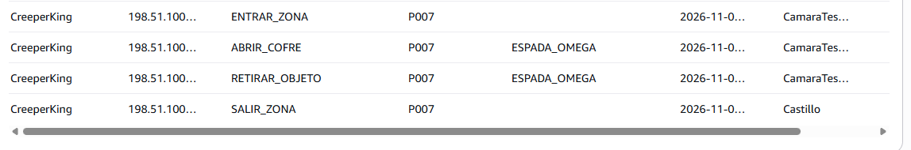

# Informe Pericial de Investigación Forense · Caso 07-OMEGA

- **Estudiante / Analista:** Javier Pulido Alcón
- **Fecha de emisión:** [2026-11-10]
- **Caso:** Sustracción de la Espada Omega en ÁgoraCraft
- **Fuente de auditoría:** Tabla `EscapeRoomMinecraft` (Amazon DynamoDB, región `us-east-1`)

---

## 1. Dictamen pericial

> Resume las conclusiones de tu investigación (máximo 120 palabras), identificando quién cometió el robo, cuándo ocurrió, cómo aprovechó el fallo del servidor y cuál fue el destino final del objeto.

El usuario que cometió el robo fue CreeperKing con id P007, ocurrió el 2026-11-02T22:15:18 , aprovecho que a las 2026-11-02T22:14:00 hubo una incidencia de red para coger el objeto darselo a ShadowPixel con id P009 y este lo ocultó.

---

## 2. Cronología forense probada

Registra al menos 5 eventos clave demostrados fehacientemente con consultas a DynamoDB (incluye marcas de tiempo ISO exactas al segundo):

| Hora exacta (ISO) | ID Cuenta | Alias | Acción / Evento | Zona | Objeto y detalles clave |
|---|---|---|---|---|---|
| `2026-11-02T22:09:00` | `P011` | AdminSol | `DEPOSITAR_OBJETO` | `CamaraTesoro` | `ESPADA_OMEGA` (custodia inicial) |
| `2026-11-02T22:14:00`|`P011` |AdminSol |`INCIDENCIA_RED` | `Castillo`| |
| `2026-11-02T22:14:10`|`P007` |CreeperKing |`ENTRAR_ZONA` | `CamaraTesoro`| |
| `2026-11-02T22:15:02`|`P007` |CreeperKing |`ABRIR_COFRE` | `CamaraTesoro`|`ESPADA_OMEGA` |
| `2026-11-02T22:15:18`|`P007` |CreeperKing |`RETIRAR_OBJETO` | `CamaraTesoro`|`ESPADA_OMEGA`  |
| `2026-11-02T22:17:44`|`P009` |ShadowPixel |`RECIBIR_OBJETO` | `BosqueOscuro`|`ESPADA_OMEGA` |

---

## 3. Identificación de responsabilidades

- **Autor material del robo:** CreeperKing con id P007
- **Cómplice y receptador:** ShadowPixel con id P009
- **Momento exacto del robo físico:** 22:15:18
- **Momento oficial de denuncia y alarma:** 22:25:00
- **Última ubicación conocida del objeto:** BosqueOscuro

---

## 4. Distinción forense: Hechos observados vs. Inferencias

- **Hecho probado (con evidencia en registros):**  
  CreeperKing fue el usuario que retiro la espada omega del cofre en la camara del tesoro.
  

- **Inferencia lógica razonable:**  
  CreeperKing y ShadowPixel estan en el mismo sitio fisicamente ya que tienen ambos la misma ip.

- **Limitación técnica del dato:**  
  Compartir una misma IP pública no significa que las conexiones pertenezcan a una sola persona, ya que varios dispositivos y usuarios pueden utilizar la misma dirección IP, por ejemplo, al conectarse a una misma red Wi-Fi. Por eso, una IP identifica una conexión a Internet, pero no permite saber con seguridad quién es la persona que la utiliza.

---

## 5. Análisis de eficiencia y Big Data en DynamoDB

1. **Operación de tipo Scan:**
   - ¿Qué consulta de tu investigación fue un `Scan`?
   - *Consulta PartiQL:* `SELECT * FROM "EscapeRoomMinecraft" WHERE  fechaHora BETWEEN '2026-11-02T22:10:00' AND '2026-11-02T22:20:00' AND zona = 'Castillo' OR zona = 'CamaraTesoro'`
   - ¿Por qué el motor ejecutó un Scan y qué impacto tendría este patrón en una tabla con 500 millones de registros?
   - El motor ejecutó un Scan porque tuvo que recorrer los registros de la tabla para encontrar los datos que cumplían las condiciones de la consulta, en lugar de utilizar un índice que le permitiera localizarlos directamente. En una tabla con 500 millones de registros, este patrón sería muy poco eficiente, ya que tendría que revisar una enorme cantidad de datos, aumentando el tiempo de ejecución, el consumo de CPU y memoria y la carga del sistema. Para evitarlo, sería recomendable crear índices adecuados sobre los campos utilizados en las consultas.

2. **Operación sobre Global Secondary Index (GSI):**
   - ¿Qué consulta utilizó el índice `PorObjeto`?
   - *Consulta PartiQL:* `SELECT * FROM "EscapeRoomMinecraft"."PorObjeto" WHERE objeto = 'ESPADA_OMEGA'`
   - ¿Qué ventaja técnica aportó la proyección `ALL` frente a consultar la tabla base?
   - La proyección ALL permitió consultar todos los campos de la tabla de forma directa, evitando tener que especificar cada columna manualmente. Esto facilita las consultas y permite recuperar toda la información disponible sin modificar la tabla original.
